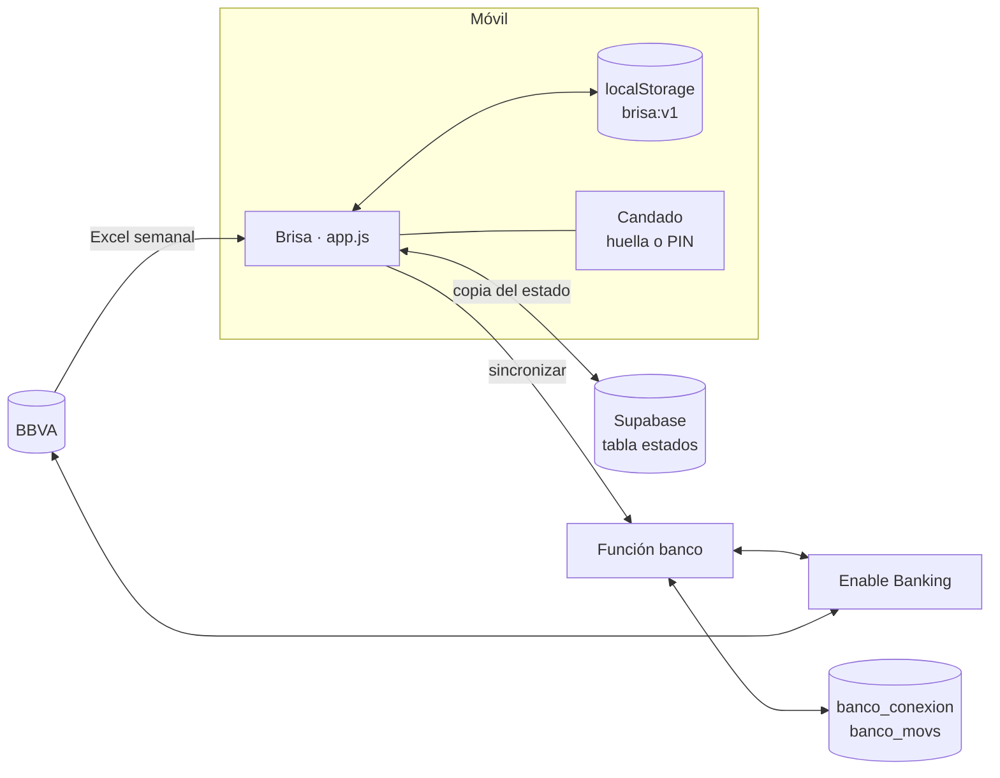

# Brisa · documentación técnica

Brisa es una app web instalable (PWA) en HTML, CSS y JavaScript sin frameworks. Funciona entera en el móvil: lee los movimientos del banco, los categoriza y calcula cuánto se puede gastar hoy. Opcionalmente guarda una copia en Supabase y trae los movimientos de BBVA a través de Enable Banking.

Versión documentada: **0.4.7** (octubre de 2026). La guía para quien usa la app está en [`guia.html`](guia.html).

---

## 1. Mapa de archivos

| Archivo | Qué hace |
| --- | --- |
| `index.html` | Esqueleto: contenedor `#app`, barra de navegación, hoja inferior `#sheet` y selector de archivos. Carga los scripts en orden. |
| `app.js` | Toda la app: estado, cálculos, pantallas (router por `#hash`), nube, conexión con el banco y candado. |
| `categorizador.js` | Lee el Excel (`leerExtracto`) y categoriza movimientos (`categorizar`, `aprender`). Sin dependencias; también funciona en Node. |
| `reglas-iniciales.js` | Reglas de partida, **vacías a propósito**: el repositorio es público. |
| `styles.css` | Estilos. Los colores son variables en `:root`. |
| `guia.html` | Guía de uso con la identidad de Brisa. Se abre desde Ajustes. |
| `sw.js` | Service worker: red primero (sin caché HTTP) y, sin conexión, la copia guardada. |
| `manifest.webmanifest` | Nombre, iconos y colores para instalarla. |
| `nube-config.js` | URL de Supabase y clave **publicable** (puede ser pública). |
| `supabase.js`, `xlsx.core.min.js` | Librerías (cliente de Supabase y SheetJS) servidas desde el propio repo. |
| `supabase/functions/banco/index.ts` | Función de Supabase que habla con Enable Banking. Se despliega en Supabase, no en GitHub Pages. |

**Datos personales:** nunca van al repositorio. Las reglas y pagos fijos de cada persona se cargan desde un `.json` propio (Ajustes → Restaurar copia o reglas).

## 2. Cómo está montada



- **El móvil es la fuente principal.** Todo el estado vive en `localStorage` bajo la clave `brisa:v1`.
- **La nube es una copia.** Al cambiar algo se sube 1,5 s después; al abrir, se baja si la de la nube es más nueva (gana el `actualizado` más reciente).
- **El banco es otra entrada de movimientos**, igual que el Excel. Los dos caminos acaban en `S.movs`.

## 3. El estado (`S`)

Un único objeto JSON, guardado con `guardar()`:

| Clave | Contenido |
| --- | --- |
| `perfil` | `{ nombre, ingresos, diaCobro, fijos, ritmo }`. `ritmo` es `suave`, `equilibrado` o `ambicioso`. |
| `movs` | Movimientos, el más reciente primero: `{ id, fecha, fechaValor, concepto, tipo, importe, saldo, observaciones }`. Los del banco llevan además `ref` y `origen: 'banco'`. |
| `reglas` | `{ reglasUsuario, palabras, importes }`: lo aprendido de las correcciones y las reglas cargadas. |
| `overrides` | Categoría elegida a mano por movimiento (`id → categoría`). |
| `fijos` | Pagos fijos. Mensual: `{ id, nombre, importe, dia, busca, min, max, desde, hasta }`. A plazos: además `cuotas: [{ fecha, importe }]`. |
| `fijosEstado` | Marcas manuales de pagado o pendiente por cargo. |
| `metas` | `[{ id, nombre, objetivo }]`, en orden: se llenan una tras otra. |
| `ahorro` | `{ base, vistos }`: saldo de partida del ahorro y movimientos ya incluidos en él. |
| `limiteRescates` | Euros al mes que la persona se permite rescatar (150 por defecto). |
| `retenido` | `{ importe, fecha, auto? }`: pagos con tarjeta aún no reflejados. Con el banco conectado llega solo. |
| `reservas` | Compras de «¿Me lo compro?» pendientes de aparecer: `{ id, nombre, importe, fecha }`. |
| `deseos` | Lista de deseos: `{ id, nombre, importe, creado }`. |
| `devol` | Devoluciones por Bizum: `idBizum → idGasto`. Ese Bizum se resta del gasto y no cuenta como ingreso. |
| `devolNo` | Bizum recibidos que la persona dijo que no son devoluciones (`idBizum → true`): no se vuelven a proponer. |
| `plan` | Topes por categoría aplicados desde Presupuesto. |
| `banco` | `{ conectado, hasta, ultima, caducada, error, cuentas }` si BBVA está conectado. |
| `ultimaImportacion` | Resumen del último Excel o sincronización (para la pantalla «Excel leído»). |

`migrar()` actualiza estados de versiones anteriores al abrir la app (ids nuevos, limpieza de duplicados, claves que faltan).

Fuera de `S`, solo en el móvil y **nunca en la nube**: `brisa:candado` (PIN cifrado e id de la credencial de huella) y `brisa:uso` (última vez que se usó la app).

## 4. Movimientos

**Id de un movimiento:** `fecha | fechaValor | importe | saldo`. BBVA cambia el texto del concepto entre descargas, así que el texto no forma parte del id. Volver a subir el mismo Excel no duplica nada.

**Categorización** (`categorizador.js`), por capas y en este orden:

1. Reglas exactas aprendidas de las correcciones.
2. Traspasos entre cuentas propias (por el nombre de la titular), que no son gasto.
3. Palabras clave de la persona.
4. Bizum, según las palabras de su concepto.
5. Diccionario de comercios.
6. Lo que no encaja va a «Por revisar».

Una categoría con confianza menor de 0,7 aparece en «Por revisar».

**Excel y banco a la vez:** al importar de un lado se descartan los movimientos que ya llegaron del otro con la misma fecha e importe (se cuentan, así que dos cafés iguales el mismo día no se pierden).

## 5. Los cálculos

### Ciclo de cobro
Empieza el día de la última nómina detectada (concepto con «nómina», de hace 35 días como mucho) y acaba el siguiente día de cobro del perfil.

### Plan del mes (`plan()`)
- **Cobras:** mediana de las 3 últimas nóminas (o lo escrito en el perfil).
- **Fijos:** cada fijo mensual activo una vez, más las cuotas que caen en el ciclo.
- **Gasto normal:** media del gasto variable de los meses completos, sin gastos grandes.
- **Día a día** = gasto normal × (1 − ritmo), con ritmo 5, 10 o 20 %.
- **Para ti** = cobras − fijos − día a día (lo que se puede ahorrar).

### Número del día (`ciclo()`)

```
libre = mín(día a día − gastado − reservado,
            saldo − fijos pendientes − retenido − reservado)
```

El dinero libre se reparte entre los días hasta el cobro según el **peso de cada día de la semana** (cuánto se suele gastar ese día, por fecha valor, entre 0,5 y 2). Lo de hoy es «Hoy puedes gastar». La tarjeta del finde suma viernes, sábado y domingo.

**Corazones** = libre ÷ día a día × 10, redondeado.

### Gastos que no restan del día a día
- Categorías fijas: Deporte, Suscripciones, Seguros, Facturas, Mascotas, Impuestos y comisiones, más lo que las reglas personales marquen como fijo.
- Cargos que encajan con un pago fijo.
- **Gastos grandes y puntuales:** 200 € o más, no fijos. Se avisan aparte.

### Devoluciones por Bizum (`sugerenciasDevol()`)
Cuando pagas tú la cuenta y tus amigas te devuelven su parte por Bizum, el gasto debe contar solo lo tuyo.
- Un Bizum recibido se propone como devolución de un gasto variable de **hasta 3 días antes** (por fecha o fecha valor) y por **no más del 110 %** de lo que queda de ese gasto.
- Si hay varios candidatos, gana el más cercano en días; ayudan que el concepto del Bizum se parezca al comercio («boltaso» → Bolt) y que el gasto sea de una categoría social (comer fuera, ocio, transporte…).
- Si dices que sí, `variable()` resta el Bizum de ese gasto (nunca por debajo de 0), y el Bizum toma la categoría del gasto con `cuentaComoGasto: false`. Así bajan la categoría, el gasto normal, Tu semana y el presupuesto. El número del día no cambia: el saldo real ya incluía el Bizum.
- A mano: en el detalle de un Bizum recibido, «Es una devolución de…» muestra los gastos de los 10 días anteriores.

### Rescates
Traspasos desde el ahorro. Un **rescate forzado** es solo la parte que tapa un saldo negativo: no cuenta en el límite.

### Ahorro y metas (`ahorro()`)
`saldo = base + apartado (nómina, redondeos, otros) − rescatado`, repartido entre las metas en orden.

### ¿Me lo compro? (`juzgarCompra()`)
Con `A` = importe (o la primera cuota si es a plazos) y `L` = dinero libre:

| Veredicto | Condición |
| --- | --- |
| Adelante | `L − A ≥ 0` y te quedan 4 € o más hoy |
| Espera al cobro (justa) | `L − A ≥ 0` pero menos de 4 € hoy |
| Espera al cobro (después) | No cabe este mes, pero `A ≤ 25 %` del presupuesto del día a día |
| Solo rescatando | El resto |

«Me lo compro» de una vez crea una **reserva**. Se cumple sola cuando llega un cargo de ese importe (±10 %, mínimo 1 €) desde la víspera. A plazos crea un **pago fijo con cuotas**, la primera hoy.

### Fijos automáticos
Cargos que se repiten cada 20–40 días con importe ±15 % se proponen como fijos. Las compras de Klarna, Scalapay y similares se detectan aparte y se pregunta cuántas cuotas quedan.

## 6. La nube (Supabase)

Proyecto `brisa`, región `eu-west-3` (París). Entrada con enlace al correo (`signInWithOtp`, flujo PKCE).

| Tabla | Para qué | Acceso |
| --- | --- | --- |
| `estados` | Una fila por persona con todo `S` en `datos` | La persona lee, crea y cambia lo suyo (RLS) |
| `banco_conexion` | Sesión de Enable Banking, validez del permiso, cuentas | La persona solo lee; escribe la función |
| `banco_movs` | Movimientos del banco en bruto (`raw`) | La persona solo lee; escribe la función |

**Límite de correo:** el envío gratuito de Supabase manda pocos enlaces por hora en todo el proyecto. Para más usuarios hace falta un servicio de correo propio (SMTP) o entrar con Google.

## 7. Conexión con BBVA

Proveedor: [Enable Banking](https://enablebanking.com/docs/api/reference/), en **modo restringido**: gratis, pero solo para las cuentas vinculadas en el panel de la persona dueña de la aplicación.

Función `banco` (Supabase Edge Function, con la sesión de la persona):

| Acción | Qué hace |
| --- | --- |
| `estado` | Si hay conexión, hasta cuándo vale el permiso y la última sincronización |
| `empezar` | Pide a Enable Banking la URL para autorizar en BBVA (permiso de 180 días, o 90 si el banco no acepta más) |
| `codigo` | Al volver de BBVA con `?code=&state=`: crea la sesión y sincroniza |
| `sincronizar` | Trae movimientos (89 días la primera vez; después, desde 10 días antes del último guardado), saldos y retenidos |
| `desconectar` | Borra la sesión |

- La clave privada está solo en el secreto `ENABLE_BANKING_KEY` de Supabase.
- La app sincroniza al abrirse si han pasado más de 2 horas.
- La vuelta de BBVA solo se reconoce si trae `state` y la conexión se empezó desde Brisa (marca `brisa:banco-pendiente`). El enlace del correo también vuelve con `?code=`, y no hay que tocarlo.
- Si el banco no da el saldo tras cada movimiento (BBVA no lo da), se reconstruye hacia atrás desde el saldo actual. Comprobado: cuadra con el saldo del Excel en todos los movimientos.
- **Solo la cuenta principal** (la que más movimientos tiene, fijada en la primera sincronización) llega a Brisa. Las demás cuentas vinculadas, como la de ahorro, se guardan en `banco_movs` pero no se mezclan con los gastos.

**Desplegar la función:** con la CLI de Supabase (`supabase functions deploy banco`) o desde el panel. Requiere el secreto `ENABLE_BANKING_KEY` (el `.pem` completo, formato PKCS#8).

## 8. Candado: huella o PIN

- Se activa en Ajustes → Privacidad → Entrar con huella.
- **PIN:** 4 cifras, guardado como SHA-256 con sal.
- **Huella:** WebAuthn con autenticador del propio móvil (`authenticatorAttachment: 'platform'`, `userVerification: 'required'`). Brisa solo guarda el id de la credencial.
- Bloquea si han pasado más de 5 minutos desde el último uso. 5 PIN incorrectos seguidos obligan a esperar 30 s.
- Es un candado de pantalla: protege frente a quien coge el móvil, no cifra los datos guardados.

## 9. Publicar una versión

1. Cambiar el número en tres sitios: `VERSION_APP` y el comentario de la primera línea de `app.js`, y `VERSION` en `sw.js` (más el título de `LEEME.md`).
2. Subir a la rama `main`. GitHub Pages publica en `https://plortega.github.io/Brisa/` en uno o dos minutos.
3. El móvil la recibe al cerrar y abrir la app: el service worker pide siempre los archivos frescos.

**Regla de trabajo:** cualquier cambio de lógica que cree o cambie botones o pantallas se refleja también en el lienzo de diseño, en la misma entrega.

## 10. Historial de versiones

| Versión | Fecha | Cambios |
| --- | --- | --- |
| 0.6.4 | 28 oct 2026 | Arreglo: Brasal (restaurante coreano) ya no se toma por un taller |
| 0.6.3 | 28 oct 2026 | Fijos que varían cada mes (gasolina): se reserva un importe al cobrar, cada cargo sale de ahí y no del día a día ni del mes típico, y avisa si te pasas. Taller, ITV y neumáticos van solos a extras |
| 0.6.2 | 28 oct 2026 | Fijos compartidos: «Lo comparto» en el detalle de un pago fijo. Brisa reserva solo tu parte, la transferencia de cada mes cuenta como devolución (no como ingreso) y avisa si no llega. Detecta sola los fijos que parecen compartidos |
| 0.6.1 | 27 oct 2026 | Modo oscuro: lo que va bien pasa de verde menta a champán dorado, que combina con el rosa. En claro sigue verde |
| 0.6.0 | 27 oct 2026 | Modo oscuro rosado. Ajustes › Apariencia: Automático (como el móvil), Claro u Oscuro. Los colores pasan a ser variables del tema |
| 0.5.2 | 27 oct 2026 | Un presupuesto aplicado empieza con la siguiente nómina (si lo aplicas en los 3 primeros días del ciclo, empieza ya). Hasta entonces el mes en curso se compara con lo típico o con el presupuesto anterior |
| 0.5.1 | 27 oct 2026 | Arreglo: el botón «Sí, fue puntual» salía sin texto (azul sobre azul) |
| 0.5.0 | 27 oct 2026 | Mes típico y extras: el presupuesto se calcula con la mediana de cada categoría (un mes raro no lo mueve); viajes, gastos de 200 € o más y lo marcado como «algo puntual» van a «Extras de este mes». «¿Fue algo puntual?» cuando una categoría se dispara. «Me voy de viaje» con fechas |
| 0.4.11 | 27 oct 2026 | Consejos: solo cuentan como suscripción los cargos de 3 meses seguidos, el mismo día y el mismo importe, y nunca las compras del día a día (súper, bares, estanco, tiendas…) |
| 0.4.10 | 27 oct 2026 | Actualizar con BBVA se ve: la tarjeta de Inicio pasa a «Actualizando…», luego «¡Listo! N movimientos nuevos» (verde) o el error en melocotón con «toca para reintentar» |
| 0.4.9 | 27 oct 2026 | Brisa te recomienda: consejos automáticos en el móvil (ritmo del mes, categorías, subidas de precio, membresías que no usas, rescates, «te han vuelto a cobrar») y «¿Y si…?» para probar un gasto nuevo mes a mes |
| 0.4.8 | 20 oct 2026 | Devoluciones por Bizum: el gasto cuenta solo tu parte. Nombres limpios para lo que llega de BBVA conectado |
| 0.4.7 | 15 oct 2026 | Si la conexión con BBVA ya existe en la nube, la app la adopta al abrirse |
| 0.4.6 | 15 oct 2026 | Conexión con BBVA: solo la cuenta principal (la de ahorro no se mezcla con los gastos) |
| 0.4.5 | 15 oct 2026 | Colores alineados con el manual de marca: la tarjeta del finde en melocotón |
| 0.4.4 | 15 oct 2026 | Guía de uso (`guia.html`), enlazada desde Ajustes |
| 0.4.3 | 15 oct 2026 | Entrar con huella o PIN |
| 0.4.2 | 15 oct 2026 | Arreglo: la vuelta de BBVA ya no se come el enlace de inicio de sesión |
| 0.4.1 | 15 oct 2026 | Las versiones nuevas llegan sin esperar a la caché de GitHub Pages |
| 0.4.0 | 15 oct 2026 | Conexión directa con BBVA (Enable Banking) |
| 0.3.3 | 15 oct 2026 | Tu semana en 1 minuto |
| 0.3.2 | 15 oct 2026 | ¿Me lo compro?: veredicto, reserva, plazos y lista de deseos |
| 0.3.0–0.3.1 | 14 oct 2026 | Copia en la nube con Supabase |
| 0.2.3 | 13 oct 2026 | Calendario de cargos y cuotas con importe propio |
| 0.2.0–0.2.2 | oct 2026 | Hábitos: fijos automáticos, plan del mes, reparto por día de la semana |
| 0.1.x | 5–7 oct 2026 | Primera versión: Excel, categorías, número del día, metas, pagos fijos |
